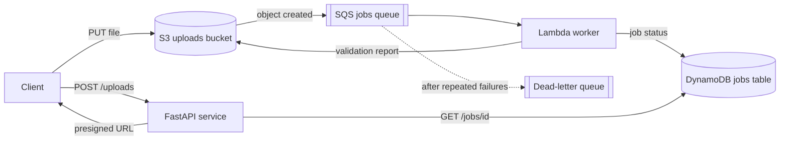

# Cloud Launchpad

[](https://github.com/Abdulrahman-Zaghloul/Cloud-Launchpad/actions/workflows/ci.yml)

An event-driven file-processing service on AWS, built one piece at a time. A client uploads a CSV,
it lands in S3, a message goes onto SQS, a Lambda worker validates the file and writes a report, and
the API shows the job's status. Everything is defined in Terraform and runs locally on
[LocalStack](https://www.localstack.cloud/), so the whole system can be built, tested and demoed with
no AWS account.

## Where it's going



What exists today is ticked in the roadmap below; the rest of the diagram is the plan.

## Roadmap

- [x] Service skeleton: FastAPI app with health and wiring endpoints, typed settings, tests, CI
- [x] Terraform for the uploads bucket (private, encrypted) and the jobs queue with a dead-letter queue, checked in CI with fmt, validate and plan
- [ ] Docker Compose with LocalStack; `make up` applies the Terraform locally
- [ ] CI job that applies the Terraform to LocalStack and checks every resource exists
- [ ] `POST /uploads`: create a job and return a presigned S3 upload URL
- [ ] S3 event notification puts a message on the jobs queue when an upload lands
- [ ] Worker that validates an uploaded CSV and writes a JSON report back to S3
- [ ] Worker packaged as a Lambda, deployed by Terraform, triggered by the queue
- [ ] DynamoDB jobs table; `GET /jobs/{id}` returns status and a report link
- [ ] End-to-end test in CI: upload, process and fetch the report, all on LocalStack
- [ ] OpenTelemetry tracing across the API and the worker
- [ ] Deploy workflow: `terraform plan` on pull requests, apply on merge

## Run it

Requires Python 3.12+ and, for the infrastructure, Terraform 1.6+.

```bash
make install     # editable install with dev tools
make check       # ruff, mypy --strict, pytest, terraform fmt/validate
make run         # API on http://localhost:8000 (docs at /docs)
```

```bash
curl localhost:8000/health   # {"status":"ok","version":"0.1.0"}
curl localhost:8000/info     # which region, bucket and queue the service is wired to
```

Settings come from `LAUNCHPAD_*` environment variables (see
[`config.py`](src/cloud_launchpad/config.py)). By default the service and the Terraform both
target LocalStack on `localhost:4566`. Set `LAUNCHPAD_AWS_ENDPOINT_URL=""` and
`use_localstack = false` to point them at real AWS.

## Design decisions so far

- **LocalStack first, real AWS second.** One flag switches both the provider and the service between
  LocalStack and AWS, so every piece can be tested in CI for free and still deploy for real.
- **A dead-letter queue from day one.** A file that keeps failing is parked after a set number of
  attempts instead of retrying forever. The redrive allow policy means only the jobs queue can use it.
- **The service and the Terraform can't drift apart silently.** A test reads the Terraform's
  `project` default and checks the service looks for the same bucket and queue names.
- **Nothing public.** The bucket blocks every form of public access and encrypts at rest.
